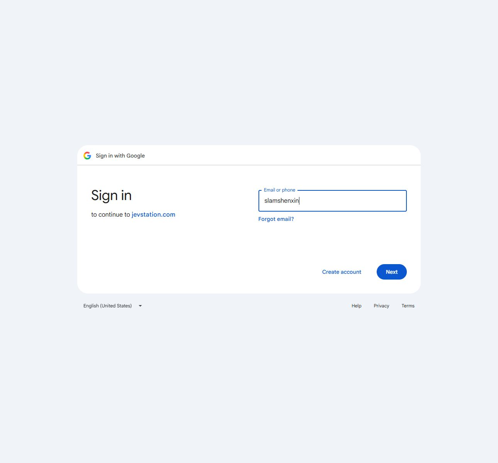

# 数据蒸馏与接入实测

2026-11-18。本轮最终范围：数据生产、教师标注、质量与任务规划；未运行SFT、未改生产服务。

## Jev确实可用

- 充值前API返回402，余额0；充值后真实返回HTTP200。
- 模型返回名：jev-1.14.0。
- 已完成155次数据标注，加1次连通性测试；共扣156 credits，已返回的最低余额为 **11,844**。
- 第一轮119条采用冻结v0.1政策；新增36条上下文对照采用v0.2。未向平台发送患者日志或身份数据。
- 网页点击发送后要求登录，显示新账号赠50点；没有验证到无限免费的独立网页通道。该网页检查发生于充值前，不代表当前账户余额。

## 已做成的首批数据包

- v0.2独立候选：**156条**，导诊42、预问诊42、info42、other30。
- 其中153条有同输入的Jev标注；部分来自旧政策，必须先复核再复用。
- 人工审核通过：**0条**。两份独立标注包已经隐藏候选标签和教师答案，并打乱顺序，供你和娜样开始试标。
- v0.1双教师初筛结果为78条普通弱标签候选、42条复核项；这不是78条人工金标，也不是v0.2训练集。
- 本地Qwen生成的60条落盘原始候选因结构/上下文/重复句式问题全部隔离；另一生成批次stage非法而失败，未计数。没有给这些批次消费Jev credits。
- 合并空白人工包的验证结果：0通过、156未决；脚本不会凭候选标签或教师一致伪造人工通过。

领取文件：

- `data/handoff_v0.2/reviewer_you.jsonl`：你的独立标注包。
- `data/handoff_v0.2/reviewer_nayang.jsonl`：娜样的独立标注包。
- `data/handoff_v0.2/candidates_with_teachers.jsonl`：两人先独立标注，再查看教师参考。
- `data/handoff_v0.2/manifest.json`：计数和文件hash。
- `data/handoff_v0.2/raw_generation_quality.json`：被隔离批次的原因。

## 原系统与精简分类器的32条开发自测

| 系统 | 匹配候选标签 | 一致率 | Macro-F1 |
|---|---:|---:|---:|
| 原入口 | 25/32 | 78.12% | 0.7586 |
| 精简四分类 | 32/32 | 100.00% | 1.0000 |
| Jev | 32/32 | 100.00% | 1.0000 |

这些标签由本次助手编写，样本和prompt也用于开发；不是独立人工测试，不能据此宣布100%上线准确率。旧接口只接受history，新输入还提供stage，任务和输入契约存在差异；这不是纯prompt消融。

原入口把部分“就诊前整理病史”和病史补充回答误送到导诊，也把“第一次来怎么挂号”等归入idle。旧registration统一映射info，旧idle统一映射other；旧idle中的澄清动作另外保存在原始预测中，所以不能只看四类映射就评价其交互质量。

原系统prompt测试长度11,968字符；本次v0.1精简分类prompt为852字符。旧入口还承担问题拆分、信息提取和回复生成，新的入口只输出分类标签。此次没有直接删掉原处理器或上线替换。

延时只保留原始请求记录供排查：Jev记录含Windows HTTP进程开销；旧系统、短prompt的调用路径、并发、预热和缓存条件也不同。本轮不据此计算正式速度提升倍数。

## 教师也会出错

Jev将“我想给门诊医生准备一个简短的病情说明”判为other；该条候选应优先复核预问诊边界。返回other=0.52、preconsult=0.43、confidence=0.36，正好说明低置信和分歧应进入人工队列。

119条初始候选与Jev一致118条；新36条三类上下文对照全部一致。后者不包含other，不能当完整四分类测试。这些数字描述与候选标签的一致程度，不等于人工金标准确率。

## 脚本验证和当前边界

- 8项离线数据约束检查通过：依赖失败不计成other、过期输入指纹拒绝、同族不跨split、冲突split不洗牌、未审核标签不能直接导出、低概率共识入复核、相同教师不算独立共识、无角色历史不能送给教师。
- 后续发现的history无role/content、非法stage等被增加为明确结构约束。
- 曾用本地Qwen3-1.7B tokenizer验证78条弱标签格式夹具的response-only mask，未加载8B权重、未训练参数；这只检查格式，不验证8B训练效果。
- 按你最新要求，后续训练、模型部署由你负责，本轮继续交付数据生产和任务清单。

下一步以 `TASKS_你和娜样.md` 为准：两人先独立试标并冻结口径，合并审核结果，再扩到MVP的4k训练、500开发与1k独立测试。目标版为20k训练、2k开发、3k独立测试。

网页验证截图：

